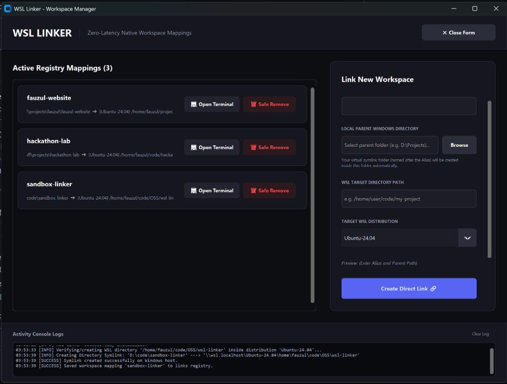
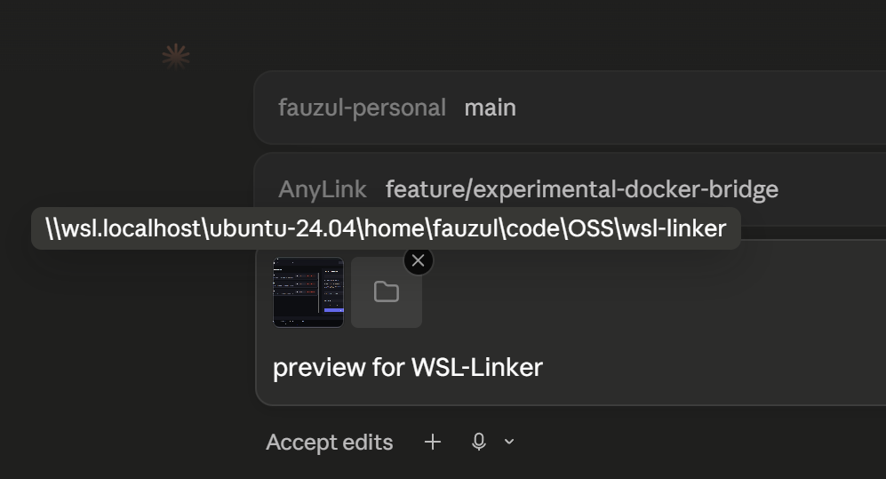

# Reddit Post Draft

## Title: [Open-Source] AnyLink: Bridge WSL2 filesystems to Windows host editors & local AI agents with zero disk lag

Hey everyone,

If you do development on Windows using WSL2, you've probably hit the classic filesystem barrier:
* Running projects from `/mnt/c/` causes your build pipelines, npm, and git to run up to 10x slower because of OS translation layers.
* Keeping projects inside WSL (`/home/user/project`) makes it tough for certain Windows tools, shell wrappers, or local AI engines to read the files, since they don't play well with UNC network paths (`\\wsl.localhost\Ubuntu\...`).

This problem hit critical mass recently when Google's Antigravity IDE updated to 2.0 and restructured its editor, breaking the standard WSL Remote Plugin workflow.

To fix this, I built and open-sourced **AnyLink** (formerly `wsl-linker`).

👉 **GitHub Repository**: https://github.com/fauzulkc/AnyLink

### How it works:
AnyLink is a lightweight desktop GUI (and CLI) built with Python/CustomTkinter. It maps your high-performance WSL2 Linux directories to local **Windows Directory Symbolic Links** (directory junctions) on your Windows host.

Windows processes (and IDEs) see a standard local path (like `D:\projects\my-app`), while the files physically live on WSL's high-speed `ext4` partition.

### Why it's crucial for the new wave of AI Agents:
With the release of **Claude Desktop**, local MCP servers, and new coding shells, we have AI agents running directly on our host machines. Many of these agentic tools crash when configuring file paths or starting active watchers on virtual UNC paths (`\\wsl.localhost\`). 

By mapping the directory with AnyLink, your AI agents have fast, stable local access to your codebase, while your compilers run at 100% native Linux speed in WSL.

### Key highlights:
* **Zero disk duplication**: Uses native Windows symlinks under the hood.
* **Safe Unlinking**: Deleting a symlink inside old versions of Windows Explorer can sometimes cause recursive deletions inside the target WSL folder. AnyLink features a "Safe Remove" button that cleanly detaches the symlink junction without touching your Linux source files.
* **Standalone Release**: I've compiled the GUI into a single-file executable (`WSL Linker.exe`) using PyInstaller inside a Wine Docker container. It has zero dependencies and runs instantly on Windows without needing Python installed on the host.
* **Proxy CLI**: Run `anylink run npm install` from your Windows shell to execute it directly inside the target WSL Linux distribution.
* **WSL Launcher Wrapper**: Intelligently restores the `antigravity` CLI inside WSL shells (which broke with the 2.0 update). It automatically detects context—using ultra-fast native Linux sockets inside integrated terminals, and automatically delegating to the Windows AppData launcher when called from external WSL shells.

* **Reverse Docker Linking (Now Live in Experimental Dev Suite)**: Spin up isolated Docker sandboxes with zero host bind mounts. Files live 100% inside the container's isolated Linux filesystem, reverse-mounted into WSL via SSHFS (`idmap=user,allow_other`), and linked to Windows as local symlinks. Includes a self-healing background daemon running every 20s that restores mounts across container restarts or Windows sleep cycles!

Try the experimental dashboard: `python experimental_linker_gui.py`

The project is completely open-source under the MIT License. Would love to get your feedback, suggestions, or contributions!

**GitHub**: https://github.com/fauzulkc/AnyLink\n